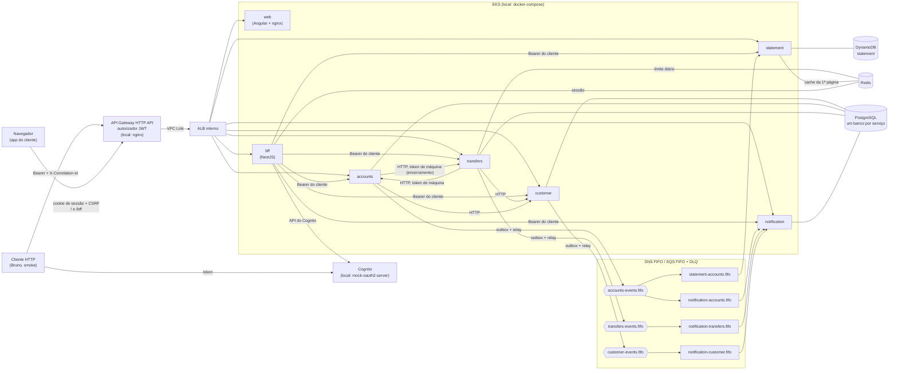

# capzzPay

O capzzPay é um banco digital **simulado**, feito para portfólio, em microsserviços: sem dinheiro real e sem dados pessoais reais. São cinco serviços em Kotlin + Spring Boot 4.1 (JDK 21), mais o app do cliente (Angular + BFF em NestJS), em monorepo com Gradle, Clean Architecture por serviço e infraestrutura na AWS com Terraform. O foco está em consistência, idempotência, mensageria confiável, cache e observabilidade.

| Serviço | Responsabilidade | Dados |
|---|---|---|
| `customer` | Cadastro e status do cliente | PostgreSQL |
| `accounts` | Contas, ledger imutável e saldo (fonte da verdade) | PostgreSQL |
| `transfers` | Saga de transferência e limite diário | PostgreSQL + Redis |
| `statement` | Extrato para leitura (CQRS) | DynamoDB + Redis |
| `notification` | Notificações dentro do aplicativo, a partir de eventos | PostgreSQL |
| `web` | App do cliente em Angular, servido por nginx | — |
| `bff` | BFF em NestJS: login, sessão e endpoints por tela | Redis |

Glossário em [`CONTEXT.md`](CONTEXT.md); arquitetura em [`docs/arquitetura.md`](docs/arquitetura.md); etapas em [`docs/roadmap.md`](docs/roadmap.md).

## Arquitetura



O `customer-events.fifo` ainda não tem consumidor. Cada fila tem a sua DLQ FIFO (5 tentativas, visibilidade de 30 s; a do extrato, `statement-accounts.fifo`, tem 120 tentativas, cerca de 1 hora).

## Pontos fortes
- **Consistência:** conta e ledger na mesma transação; o saldo fica no próprio lançamento, com trava pessimista por conta. Saldo para autorizar débito nunca vem de cache. ([ADR 0007](docs/adr/0007-conta-e-ledger-no-accounts.md), [ADR 0012](docs/adr/0012-saldo-no-lancamento-e-trava-pessimista.md))
- **Idempotência:** chave por lançamento no `accounts`, `Idempotency-Key` nas transferências, chaves derivadas por passo da saga; consumidores idempotentes por `processed_events` ou por `PutItem` condicional. ([ADR 0011](docs/adr/0011-contratos-de-api.md), [ADR 0017](docs/adr/0017-notification-com-banco-e-consumo-sqs.md), [ADR 0018](docs/adr/0018-chave-do-extrato-pela-sequencia.md))
- **Transactional Outbox:** eventos só pelo outbox, relay com líder único e SNS FIFO com ordem por conta; evento preso se destrava por descarte do admin. ([ADR 0003](docs/adr/0003-transactional-outbox-e-mensageria.md), [ADR 0015](docs/adr/0015-outbox-relay-lider-e-sns-fifo.md))
- **Saga:** transferência orquestrada por HTTP, com compensação, arrendamento e consulta do lançamento pela chave depois do prazo. ([ADR 0016](docs/adr/0016-saga-orquestrada-por-http.md))
- **Cache:** cache-aside da 1ª página do extrato no Redis, TTL com jitter, invalidação ao consumir o lançamento e fallback para o DynamoDB. ([ADR 0009](docs/adr/0009-cache-do-extrato.md))
- **Limite diário:** contador em Redis + Lua com reserva idempotente, fonte da verdade no PostgreSQL e fallback com o Redis fora. ([ADR 0010](docs/adr/0010-limite-diario-redis-lua.md))
- **Observabilidade:** correlation ID de ponta a ponta, nas chamadas HTTP, no outbox e nas mensagens. ([ADR 0006](docs/adr/0006-observabilidade-com-correlation-id.md))
- **Contratos:** OpenAPI e Problem Details em todo serviço; testes de contrato HTTP e de mensagem com Stubborn Contract. ([ADR 0011](docs/adr/0011-contratos-de-api.md), [ADR 0022](docs/adr/0022-testes-de-contrato.md))
- **Identidade:** JWT validado em cada serviço, regra de dono (recurso alheio → `404`), grupo `admin` e token de máquina entre serviços. ([ADR 0020](docs/adr/0020-identidade-e-autorizacao.md))
- **Ambiente efêmero:** a AWS sobe com um workflow e cai sozinha em 8 h. ([ADR 0019](docs/adr/0019-runtime-na-aws-com-eks.md), [ADR 0021](docs/adr/0021-deploy-e-ambiente-efemero.md))

Todos os ADRs: [`docs/adr/`](docs/adr/README.md).

## Como rodar localmente
Guia completo, para macOS e Linux: [`docs/rodando-localmente.md`](docs/rodando-localmente.md). Precisa de JDK 21, Docker e um `LOCALSTACK_AUTH_TOKEN` (conta gratuita do LocalStack). Resumo:

```bash
cp infra/local/.env.example infra/local/.env
docker compose --env-file infra/local/.env -f infra/local/docker-compose.yml up --wait
./gradlew build          # ou ./gradlew test, sem Docker
./gradlew :services:accounts:bootstrap:bootRun   # um terminal por serviço
infra/local/seed.sh http://localhost
infra/local/smoke.sh http://localhost
```

Os cinco serviços também sobem pelas imagens Docker (perfil `apps` do compose). Coleções Bruno em [`api/bruno/`](api/bruno/).

## App do cliente
Telas em português (Angular servido por nginx) com um BFF em NestJS, na mesma origem: `/` é o app e `/bff` é o BFF ([ADR 0024](docs/adr/0024-login-e-telefone-do-app.md)).
- **Local:** abra `http://127.0.0.1/` com o compose de pé. O cadastro local pula o código por e-mail.
- **AWS:** abra a URL `execute-api` que o `aws-up` mostra no resumo do job.
- **Usuário de demonstração:** o seed o cria com saldo, extrato, uma transferência recusada pelo limite e notificações. O e-mail e a senha vêm das variáveis do seed; na AWS, a senha vem de um segredo, nunca versionada.
- **Cadastro na AWS:** o Cognito usa o e-mail padrão (sem SES), com limite diário baixo de envios: serve a uma demonstração, mas muitos cadastros no mesmo dia esgotam o limite.

## Como subir na AWS
Região `sa-east-1`. **Ainda não houve subida real:** o código é validado no CI sem credenciais (`terraform validate`, `tflint`, `helm lint`, `kubeconform`, `actionlint` e testes dos scripts). Detalhes em [`infra/terraform/README.md`](infra/terraform/README.md) e [`deploy/helm/README.md`](deploy/helm/README.md).

### Uma vez, pelo usuário
1. Aplicar o stack [`infra/terraform/bootstrap`](infra/terraform/bootstrap) com credenciais de administrador da conta, informando `budget_alert_email` (variável sensível sem padrão, por exemplo em `TF_VAR_budget_alert_email`). Ele cria o bucket do estado, o papel `digital-banking-github` (OIDC, só da `main`), os repositórios ECR e o Budget de US$ 20/mês. O `bootstrap` não declara backend: o estado dele é local, na máquina de quem aplica; se ele se perder, é preciso recuperá-lo com `terraform import`.
2. Em *Settings > Secrets and variables > Actions* do repositório:
   - `vars.AWS_ROLE_ARN`: saída `github_role_arn` do `bootstrap`;
   - `vars.TF_STATE_BUCKET`: saída `state_bucket`;
   - `vars.COGNITO_DOMAIN_PREFIX`: prefixo do domínio do Cognito, único na região;
   - `vars.OWNER_EMAIL` (opcional, padrão `owner@example.test`);
   - `secrets.OWNER_PASSWORD`: senha do usuário do dono no Cognito (12+ caracteres, maiúscula, minúscula, número e símbolo).

### Workflows (só da `main`)
- **`aws-up`** (manual): constrói as sete imagens (cinco serviços, web e BFF), aplica o `envs/aws` com a etiqueta `created-at`, publica as imagens no ECR, instala o `db-init` e os serviços no EKS, roda o seed do dono e o smoke pela borda. O resumo do job traz a URL da borda e o horário da derrubada automática.
- **`aws-down`** (manual): `helm uninstall`, `terraform destroy` e conferência do que sobrou. Se sobrou algo, o job falha com a lista.
- **`aws-reaper`** (a cada 30 min): chama o `aws-down` quando o ambiente passa de 8 h, ou quando a etiqueta `created-at` falta ou está malformada. Sem `vars.AWS_ROLE_ARN`, não faz nada.

Os três rodam um de cada vez (grupo de concorrência `aws-environment`). Rodar o `aws-up` de novo não estende o prazo de 8 h.

### Custo por subida
**Estimativa, sem medição:** ainda não houve subida real. O custo é a soma das tarifas por hora dos recursos do `envs/aws` em `sa-east-1`, vezes o tempo ligado:
- cobrados por hora: plano de controle do EKS (cerca de US$ 0,10/h, [ADR 0019](docs/adr/0019-runtime-na-aws-com-eks.md)), 2× EC2 `t3.medium`, NAT Gateway com EIP, ALB interno, RDS `db.t4g.micro` e ElastiCache `cache.t4g.micro`;
- cobrados por uso, baixos num teste: API Gateway, Cognito, SNS, SQS, DynamoDB, Secrets Manager e logs no CloudWatch;
- tempo ligado: até 8 h, mais até 30 min do agendamento do reaper, o atraso do GitHub e a duração do `destroy`.

Confira as tarifas atuais na calculadora de preços da AWS. O `bootstrap` fica de pé entre as subidas, com custo pequeno (S3 e ECR). O Budget de US$ 20/mês avisa em 50%, 80% e 100%.

## Decisões principais
| Decisão | ADR |
|---|---|
| Stack Kotlin + Spring Boot 4.1 | [0001](docs/adr/0001-stack-kotlin-spring-boot-aws.md) |
| Clean Architecture por serviço, conferida com ArchUnit | [0002](docs/adr/0002-clean-architecture-por-servico.md) |
| Transactional Outbox, relay com líder único e SNS FIFO | [0003](docs/adr/0003-transactional-outbox-e-mensageria.md), [0015](docs/adr/0015-outbox-relay-lider-e-sns-fifo.md) |
| API Gateway HTTP API na borda | [0004](docs/adr/0004-api-gateway-http-api-na-borda.md) |
| Saldo no lançamento e trava pessimista | [0012](docs/adr/0012-saldo-no-lancamento-e-trava-pessimista.md) |
| Saga orquestrada por HTTP | [0016](docs/adr/0016-saga-orquestrada-por-http.md) |
| Extrato no DynamoDB, ordenado pela sequência do ledger | [0008](docs/adr/0008-statement-cqrs-dynamodb.md), [0018](docs/adr/0018-chave-do-extrato-pela-sequencia.md) |
| Limite diário com Redis + Lua | [0010](docs/adr/0010-limite-diario-redis-lua.md) |
| Identidade e autorização | [0020](docs/adr/0020-identidade-e-autorizacao.md) |
| EKS e ambiente efêmero na AWS | [0019](docs/adr/0019-runtime-na-aws-com-eks.md), [0021](docs/adr/0021-deploy-e-ambiente-efemero.md) |
| Testes de contrato com Stubborn Contract | [0022](docs/adr/0022-testes-de-contrato.md) |
| Login pela API do Cognito, senha de 6 dígitos e telefone como chave de transferência | [0024](docs/adr/0024-login-e-telefone-do-app.md) |
| Nome da contraparte nas notificações, por projeção própria no `notification` | [0025](docs/adr/0025-nome-da-contraparte-nas-notificacoes.md) |
| Bônus de boas-vindas por cliente, só na primeira conta | [0026](docs/adr/0026-bonus-de-boas-vindas-por-cliente.md) |
| DynamoDB Local com volume no ambiente local, para o extrato sobreviver ao `down` | [0027](docs/adr/0027-dynamodb-local-com-volume.md) |
